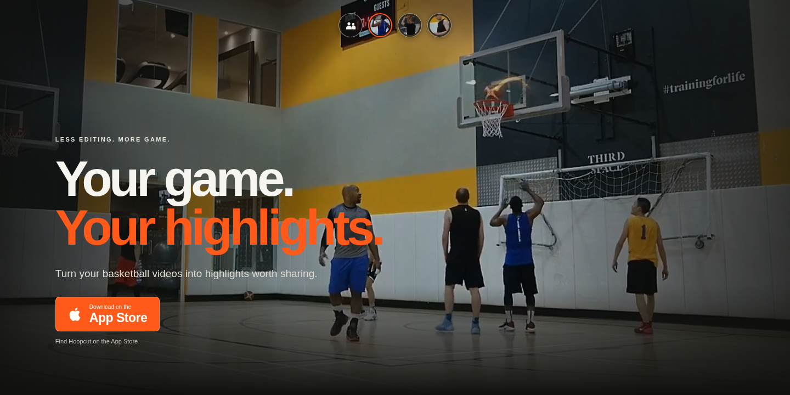
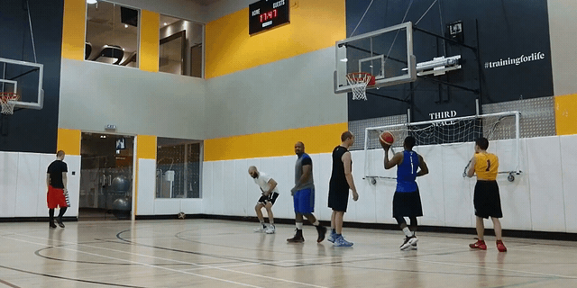

  
  <h1>Hoopcut</h1>
  
<strong>Your game. Your highlights.</strong>

  
AI basketball highlights, player-focused edits, shot trajectories and scoring. Less editing. More game.

  
<a href="https://apps.apple.com/us/search?term=hoopcut">Find Hoopcut on the App Store</a> · <a href="mailto:hello@goswie.com">Contact us</a>

## Local resource batch (2026-10-27)

The first resource batch adds five filming/senior-night guides and fifteen editable
worksheets/designs. The app remains focused on basketball clipping and Shot Tracer;
the browser resources are separate utilities. The original homepage reviews remain intact.

- Editorial source for this batch: `scripts/batch_one_content.py`.
- Existing article source: `content/blog/articles.json`.
- Shared original SVG designs: `scripts/resource_graphics.py`.
- Browser editor: `assets/resources/editor.js` (no accounts, uploads or persistence).
- Media provenance: `content/blog/batch-one-media-manifest.json`.

Build the complete blog/resource combination with `python3 scripts/build_resources.py`.
This invokes the blog builder and adds resource cards, guide walkthroughs and sitemap
entries. Use this complete build instead of invoking `build_blog.py` by itself.
After changing artwork or walkthrough labels, also run
`node scripts/build_resource_media.cjs` (requires Sharp and ffmpeg).

Validate with `python3 scripts/check_blog.py` and
`python3 scripts/check_resources.py`. Optional browser QA:
`node scripts/qa_resources.cjs` uses a separate temporary Chrome profile against
the loopback preview and stores ignored reports under `reports/`.

Preview with `python3 scripts/preview_site.py --port 8767`.
The local review directory is `/reports/batch-one-review`; it is excluded from
deployment and carries a noindex directive. Local responses always carry
`X-Robots-Tag: noindex, nofollow`. Production metadata remains in the generated source.
Building and testing do not commit, push, deploy or submit anything to GSC.

The public tool directory is `/tools`, generated by `scripts/tools_hub.py` as part
of the complete build. It groups all 15 utilities and supports optional browser
search/filtering; all links remain available without JavaScript. Tool URLs stay
under `/templates/`. Blog articles and the tool directory are separate navigation
items, with contextual entry points from the homepage and Blog. Validate the
navigation journey with `node scripts/qa_tools.cjs` against the local preview.

`python3 scripts/check_site_seo.py --http` audits every sitemap page against the
local preview: metadata uniqueness, canonical alignment, structured data,
breadcrumbs, internal discovery, images and HTTP status. All 39 public URLs
must be reachable from the homepage. Terms and Privacy are footer links;
primary navigation is reserved for the product, demos, tools and articles.

## From a full game to the plays that matter

You came to play basketball. Reliving the best moments should be easy.

Hoopcut helps turn basketball footage into highlights worth sharing. Find the action with AI, focus on a player, bring made shots to life with trajectory effects, and keep track of the score.

| Find your best plays | Make the edit yours |
| --- | --- |
| **AI highlight detection** — Find key basketball moments without scrubbing through the entire recording. | **AI editing** — Bring selected moments together into a highlight reel ready to export and share. |
| **Player selection** — Focus on one player and watch their made shots together. | **Shot Tracer** — Visualize the ball’s flight so each shot is easier to follow. |
| **Basketball scoring** — Keep track of the score alongside the action. | **Shareable highlights** — Take the moments that matter back to your team and group chat. |

## Follow every shot

The play, the release, the finish. Shot trajectories make the ball’s journey visible while keeping the basketball footage at the center of the edit.

  
  
<a href="assets/video/players/blue.mp4">Watch the player highlight reel</a>

## One game. Different perspectives.

Choose the whole game’s made shots or focus on a single player. The website’s interactive banner switches between real highlight reels, so you can see what player selection looks like in practice.

<table>
  <tr>
    <th align="center">Blue #1</th>
    <th align="center">Red shorts</th>
    <th align="center">Black kit</th>
  </tr>
  <tr>
    <td align="center"></td>
    <td align="center"></td>
    <td align="center"></td>
  </tr>
  <tr>
    <td align="center"><a href="assets/video/players/blue.mp4">5 made shots</a></td>
    <td align="center"><a href="assets/video/players/red.mp4">2 made shots</a></td>
    <td align="center"><a href="assets/video/players/black.mp4">1 made shot</a></td>
  </tr>
</table>

[Watch all 10 made shots](assets/video/players/all.mp4) from the sample game. Two additional plays remain in the full reel without an individual player assignment.

## A simple path from footage to highlights

1. **Bring your game.** Import your basketball recording.
2. **Find your moments.** Let AI help identify plays and focus on the player you want to watch.
3. **Shape the highlight.** Build your edit and make shots stand out with trajectory effects.
4. **Share the game.** Export the result for teammates, friends and your next post.

AI detections and scores can need correction. Review your results before sharing.

---

  <h3>Keep the play. Share the moment.</h3>
  
<a href="https://apps.apple.com/us/search?term=hoopcut">Find Hoopcut on the App Store</a>

  
<a href="mailto:hello@goswie.com">hello@goswie.com</a> · <a href="https://hoopcut.ai/terms">Terms</a> · <a href="https://hoopcut.ai/privacy">Privacy</a>

## SEO audit follow-up (local, 2026-10-28)

The complete `python3 scripts/build_resources.py` now runs responsive media
optimization and `scripts/polish_site.py` as its final pass. Re-running it produces
the same public HTML. Do not deploy an intermediate `build_blog.py` output.

- App access is configured in `content/site-config.json`. The current distribution
  is TestFlight. With no verified public join URL, access buttons open a request
  to the existing contact email. A real join URL can replace that fallback later.
- `scripts/optimize_media.cjs` uses Sharp and ffmpeg to retain the full 52-second
  sample and all player reels at 960px and 640px; original assets remain available.
  It adds responsive WebP sizes without changing the graphic editor's SVG/PNG output.
- Files under `assets/optimized/` and `assets/static/` use content hashes. Only those
  paths have year-long immutable cache headers. HTML and editable source assets
  keep their existing update behavior.
- `assets/site-events.js` prepares anonymous tool/demo/access events. Analytics is
  disabled in config and makes no requests from localhost. Enable Vercel Web
  Analytics for the project before enabling page views. Custom events currently
  require Vercel Pro/Enterprise; do not upgrade or enable billing automatically.
  Only enable `customEvents` after confirming entitlement. Preview debug events
  can be observed by setting `window.__HOOPCUT_ANALYTICS_DEBUG__ = true` before load
  and listening for `hoopcut:analytics-debug`; no form contents are included.
- A host-specific www redirect is prepared in `vercel.json`. It cannot repair TLS
  by itself: the www domain must first be bound and have a valid certificate in
  the hosting account. See `production/seo-audit-rollout.md`.

Checks: `python3 scripts/check_site_seo.py --http`,
`python3 scripts/check_blog.py`, `python3 scripts/check_resources.py`, and
`node scripts/qa_audit_fixes.cjs`. Existing `qa_resources.cjs` / `qa_tools.cjs`
cover all 15 browser tools. The preview runs on `http://127.0.0.1:8767/` and
always returns `X-Robots-Tag: noindex, nofollow`.
